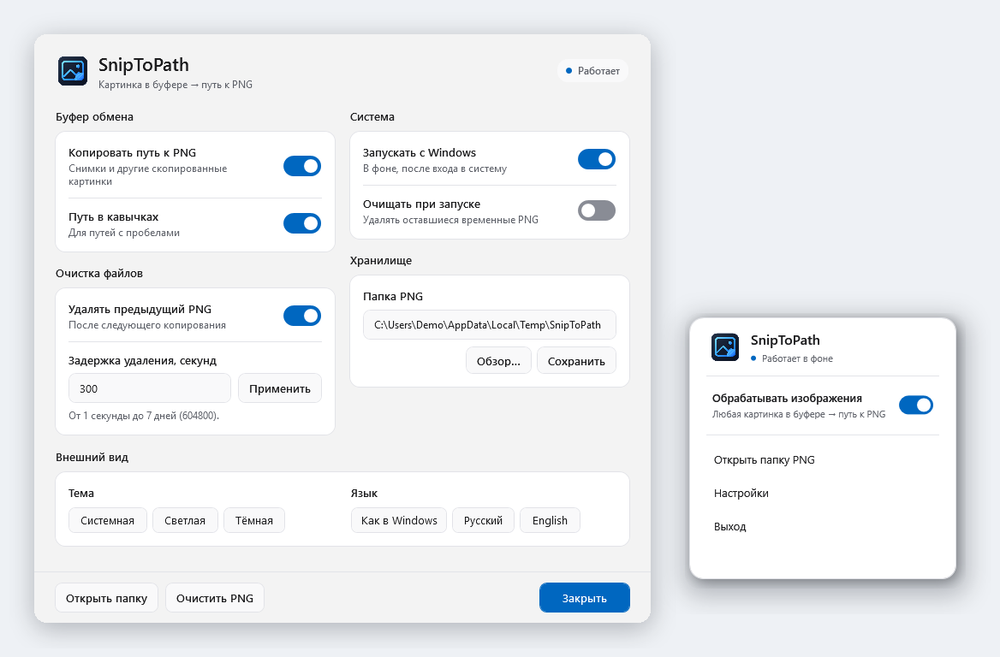

<p align="center">
  
</p>

# SnipToPath

[English documentation](README.en.md)

Когда работаешь с Codex CLI или Claude Code в консоли, вставить скриншот не всегда получается. SnipToPath сохраняет скопированное изображение в PNG и кладёт в буфер обмена путь к файлу.

Можно сделать скрин через `Win + Shift + S` или `Print Screen`, а можно просто скопировать картинку из браузера или другого приложения. После этого вставляешь путь в терминал через `Ctrl + V` и пишешь свой запрос. Если не вставляется, попробуй `Ctrl + Shift + V`.

<p align="center">
  
</p>

**Важно:** вставляется путь, а не само изображение. У агента должен быть доступ к PNG на диске.

## Установка

Открой PowerShell и вставь:

```powershell
irm https://raw.githubusercontent.com/alkatrazzjr/SnipToPath/main/install.ps1 | iex
```

Работает на Windows 10/11 без прав администратора и дополнительных программ. После установки SnipToPath появится в меню «Пуск» и в трее возле часов. Для обновления запусти ту же команду ещё раз — настройки сохранятся.

## Трей

Правый клик по иконке открывает небольшое меню: **обрабатывать изображения**, **открыть папку PNG**, **настройки** и **выход**. Папка открывается прямо в Проводнике. Двойной клик по иконке открывает настройки сразу.

## Настройки

По умолчанию SnipToPath использует тему Windows. В настройках можно выбрать светлую или тёмную тему вручную, сменить язык, включить автозапуск, поставить обработку изображений на паузу и изменить папку PNG. Если уменьшить окно, настройки можно прокручивать — полоса прокрутки подстраивается под выбранную тему. Путь можно вписать вручную и нажать «Сохранить» или выбрать папку через «Обзор». Если такой папки ещё нет, программа создаст её.

**Язык:** «Как в Windows» (по умолчанию), «Русский» или «English». Если язык Windows русский — интерфейс будет на русском, для остальных языков — на английском. Язык можно переключать прямо в настройках, без перезапуска.

По умолчанию PNG лежат в `%TEMP%\SnipToPath`.

Чтобы файлы не накапливались, SnipToPath ставит предыдущую картинку на удаление после **следующего копирования в буфер**. Задержку можно задать самостоятельно в секундах: например, `30`, `120` или `600`. По умолчанию — `300` секунд. Допустимый диапазон — от 1 секунды до 7 дней.

При слишком короткой задержке Codex или Claude могут не успеть открыть изображение. Поэтому для значений меньше 30 секунд программа показывает предупреждение. Автоудаление можно отключить.

У SnipToPath собственная иконка в меню «Пуск» и на панели задач. Если раньше закреплял там PowerShell, открепи старый значок и закрепи SnipToPath заново.

При запуске SnipToPath также может удалять оставшиеся временные PNG. Это отдельная настройка. Есть и ручная очистка через окно настроек. После удаления PNG старый путь перестанет работать.

Программа не отправляет изображения в интернет. Она обрабатывает **любые изображения из буфера обмена**, не только скриншоты. Обычный скопированный текст не меняет.

## Удаление

В PowerShell:

```powershell
powershell.exe -NoProfile -ExecutionPolicy Bypass -File "$env:LOCALAPPDATA\SnipToPath\SnipToPath.ps1" -Uninstall
```

Если нашёл ошибку — напиши в [Issues](https://github.com/alkatrazzjr/SnipToPath/issues).

[MIT](LICENSE)
